# Elements

This file is a complete breakdown of every element grassmessage provides.

## Legend

This legend covers labels that you might see in the [Elements](#element-list) section.

### Class labels

- **_l_ (literal):** Input must be supplied directly; variable references are not allowed here. (e.g. `500`, `minecraft:diamond_sword`, ``)
- **_v_ (variable):** Input must be a variable reference (e.g. `$(open_menu)`, `$(click_dur)`, `$(enchants)`)
- **_f_ (flexible):** Input can be either supplied directly or a variable reference (e.g. `2`, `$(intro_page)`, `#FF0000`, `$(bg_color)`)
- **_m_ (mixed):** Variable references can be combined with direct input (e.g. `Hello, $(player_name)!`, `{transaction_name: "$(txn_name)"}`).

### Type labels

- **_str_**: unrestricted text
- **_int_**: unrestricted integer
- **_pint_**: integer greater than 0
- **_nnint_**: integer greater than -1
- **_bool_**: a boolean (`true`, `false`, `1` or `0`)
- **_frac_**: a decimal between 0 and 1, both exclusive
- **_data_**: a data component value, used to add special properties to items
- **_uuid_**: a UUID, specified through the standard 8-4-4-4-12 pattern of hex digits
- **_nbt_**: a named binary tag, used to add special properties to custom click events
- **_dialog_**: a dialog
- **_click_**: a callback to a click event
- **_dur_**: a duration, specified through a combination of days, hours, minutes and seconds in descending order
  (e.g. `3d12h`, `100m`, `5s`, `1h40m`)
- **_col_**: an RGB text color, specified through the `#RRGGBB` format
- **_shadcol_**: an ARGB shadow color, specified through the `#RRGGBBAA` format
- **_adv_**: an adventure component

If an element/attribute in the [Element List](#element-list) below
does not have a class label and type label, its expected input is explained in its section.

### Quantity labels

- **_opt_**: 0 or 1 of this element
- **_unlim_**: Any number of this element

If an element/attribute in the [Element List](#element-list) below
does not have a quantity label, it is expected to be used exactly once.

## Element List

### Named colors

The tags
`<black>`, `<dark_blue>`, `<dark_green>`, `<dark_aqua>`,
`<dark_red>`, `<dark_purple>`, `<gold>`, `<gray>`,
`<dark_gray>`, `<blue>`, `<green>`, `<aqua>`,
`<red>`, `<light_purple>`, `<yellow>`, `<white>`
correspond to the 16 named Minecraft chat colors.
Wrap them around your text to give them one of those colors.


- **Example**:
```xml
<green>I'm green now!</green>
```

- **Result**: <p>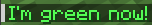</p>

### Text decorations

- `<b>`, `<bold>`: **bold text**
- `<i>`, `<italic>`: _italic text_
- `<u>`, `<underlined>`: <u>underlined text</u>
- `<st>`, `<strikethrough>`: ~~strikethrough text~~
- `<obf>`: obfuscated (magic) text


- **Example**:
```xml
<aqua>I <i>really</i> want to <b>emphasize</b> this.</aqua>
```

- **Result**: <p></p>

### `<font>`

- **Description**: Applies a font to the content within.


- **Attributes**:
  - `font` ([_m_](#class-labels), [_str_](#type-labels)): a key representing the font to be used (e.g. `minecraft:uniform`)


- **Example**:
```xml
<font font="minecraft:uniform">
  <red>1 2 3 4 5</red>
</font>
```

- **Result**: <p>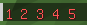</p>

### `<insertion>`

- **Description**: Applies an insertion text to the content within.
This means that Shift-clicking the text will insert some other text into the player's chat bar.


- **Attributes**:
  - `text` ([_m_](#class-labels), [_str_](#type-labels)): the text that will be inserted into the chat bar


- **Example**:
```xml
<insertion text="Hi!">
  <aqua>Shift-click on me to say hi!</aqua>
</insertion>
```

- **Result**: <p>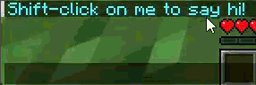</p>

### `<color>`

- **Description**: Applies a text color to the content within.


- **Attributes**:
  - `hex` ([_f_](#class-labels), [_col_](#type-labels)): the text color as a hex string


- **Example**:
```xml
<color hex="#456789">
  I am a bit red, a bit more green and a bit more blue!
</color>
```

- **Result**: <p></p>
 
### `<shadow>`

- **Description**: Applies a shadow color to the content within.


- **Attributes**:
  - `hex` ([_f_](#class-labels), [_shadcol_](#type-labels)): the shadow color as a hex string


- **Example**:
```xml
<shadow hex="#FFFFFFFF">
  <black>The tables have turned!</black>
</shadow>
```

- **Result**: <p>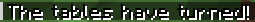</p>

### `<gradref>`

- **Description**: Applies a gradient declared in [&lt;gradient&gt;](#gradient) to the content within.


- **Attributes**:
  - `ref` ([_l_](#class-labels), [_str_](#type-labels)): the name of the gradient


- **Content** ([_m_](#class-labels), [_str_](#type-labels)): the text to be made a gradient (cannot be rich text)


- **Example**:
```xml
<!-- gradient "grayscale" declared to go from #000000 to #FFFFFF -->
<gradref ref="grayscale">
  BLACK------AND------WHITE
</gradref>
```

- **Result**: <p>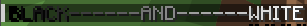</p>

### `<styleref>`

- **Description**: Applies a style declared in [&lt;style&gt;](#style) to the content within.


- **Attributes**:
  - `ref` ([_l_](#class-labels), [_str_](#type-labels)): the name of the style


- **Example**:
```xml
<!-- style "excessive_decoration" declared with bold="true", italic="true", underlined="true", strikethrough="true" -->
<styleref ref="excessive_decoration">
  I am very lively!
</styleref>
```

- **Result**: <p>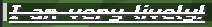</p>

### `<translatable>`

- **Description**: Adds a translatable component.


- **Subelements (in order)**:
  - `<key>` ([_m_](#class-labels), [_str_](#type-labels)): the translation key (e.g. `death.fell.accident.water`)
  - `<with>` ([_unlim_](#quantity-labels)): paremeters (rich text components) that the translated entry needs (e.g. player names or amounts of items)
  - `<fallback>` ([_m_](#class-labels), [_str_](#type-labels), [_opt_](#quantity-labels)): a fallback entry in case the entry for the translation
key cannot be found


- **Example**:
```xml
<translatable>
  <key>commands.give.success.single</key>
  <with><yellow>59</yellow></with>
  <with><gold>Oak Planks</gold></with>
  <with><aqua>Array64</aqua></with>
  <fallback>%1$s x %2$s -> %3$s</fallback>
</translatable>
```

- **Result**: <p>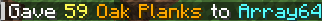</p>

### `<keybind>` ([_m_](#class-labels), [_str_](#type-labels))

- **Description**: Adds a keybind component.


- **Content**: the keybind identifier (e.g. `key.jump`, `key.sneak`)


- **Example**:
```xml
<i>Hold <keybind>key.sprint</keybind> to sprint!</i>
```

- **Result**: <p>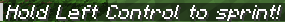</p>

### `<selector>`

- **Description**: Adds a selector component.


- **Subelements (in order)**:
  - `<pattern>` ([_m_](#class-labels), [_str_](#type-labels)): the player name
  - `<separator>` ([_opt_](#quantity-labels)): a rich text component separating the entities selected


- **Example**:
```xml
<i>Players: <selector>
  <pattern>@a</pattern>
</selector></i>
```

- **Result**: <p>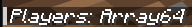</p>


- _Warning: Unresolved component. [See below.](#unresolved-components)_

### `<score>`

- **Description**: Adds a score component.


- **Subelements (in order)**:
  - `<name>` ([_m_](#class-labels), [_str_](#type-labels)): the player name
  - `<objective>` ([_m_](#class-labels), [_str_](#type-labels)): the objective
  - `<default>` ([_m_](#class-labels), [_str_](#type-labels), [_opt_](#quantity-labels)): the default value
    if the score is unavailable (expired in 1.16.5)


- **Example**:
```xml
<i>You have died <score>
  <name>Array64</name>
  <objective>deathCount</objective>
</score> times!</i>
```

- **Result**: <p>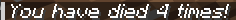</p>


- _Warning: Unresolved component. [See below.](#unresolved-components)_

### `<ln/>`

- **Description**: Adds a new line.


- **Example**:
```xml
<gold>69</gold> <ln/>
<white>+</white><gold>3</gold> <ln/>
<white>--</white> <ln/>
<aqua>72</aqua>
```

- **Result**: <p>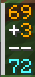</p>

### `<glue/>`

- **Description**: Removes the space between two tags (or text) if you insert this element between them.


- **Example**:
```xml
<b>B</b> <glue/>
<i>I</i> <glue/>
<u>U</u> <glue/>
<st>S</st> <glue/>
<obf>O</obf>
```

- **Result**: <p>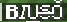</p>

### `<nbsp/>`

- **Description**: Adds more than one space (useful as whitespace is collapsed).


- **Attributes**:
  - `spaces` ([_l_](#class-labels), [_int_](#type-labels), [_opt_](#quantity-labels)): the number of spaces to insert; default is `1`


- **Example**:
```xml
<gold>[</gold>
<nbsp spaces="10"/>
<yellow>LOADING</yellow>
<nbsp spaces="10"/>
<gold>]</gold>
```

- **Result**: <p>!["[          LOADING          ]"](../images/ElementNbsp.png)</p>

### `<embed_msg/>`

- **Description**: Embeds a different message referenced by name.


- **Attributes**:
  - `ref` ([_l_](#class-labels), [_str_](#type-labels)): the `name`  of the `<message>` to embed


- **Example**:
```xml
<!--
<message name="line">
    <gray>----------------</gray>
</message>
-->
<embed_msg ref="line"/><ln/>
<i>Diamonds found: <aqua>62</aqua></i>
<ln/><embed_msg ref="line"/>
```

- **Result**: <p>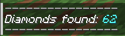</p>

### `<adventure/>`

- **Description**: Embeds a `net.kyori.adventure.text.Component` provided through a variable source.


- **Attributes**:
  - `src` ([_v_](#class-labels), [_adv_](#type-labels)): the variable reference to the Adventure component


- **Example**:
```xml
<adventure src="$(welcome)"/>
<yellow>Enjoy your stay!</yellow>
<!-- grass.message("welcome")
    .addAdventureComponent("welcome", Component.text("Welcome!"))
    .build() -->
```

- **Result**: <p>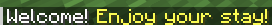</p>

### `<pre>`

- **Description**: Preserves whitespace.
  

- **Attributes**:
  - `dedent` ([_l_](#class-labels), [_bool_](#type-labels), [_opt_](#quantity-labels)): whether to dedent the content within; default is `true`
  - `trim_bounds` ([_l_](#class-labels), [_bool_](#type-labels), [_opt_](#quantity-labels)): whether to trim the blank lines before
and after the content within (`trim_bounds="false"` will still remove up to one newline directly after the
`<pre>` tag and one directly before the `</pre>` tag, such that only the middle lines i.e. the content lines are kept);
default is `true`
  - `inline` ([_l_](#class-labels), [_bool_](#type-labels), [_opt_](#quantity-labels)): whether to append a newline to the content within
if the `</pre>` tag is followed by other content; default is `false`


- **Example**:
```xml
<pre>
  <gold>[</gold>        <yellow>LOADING</yellow>        <gold>]</gold>
  <i><gray>25%...</gray>
  <gray>50%...</gray>
  <gray>75%...</gray></i>
</pre>
```

- **Result**: <p>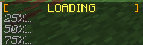</p>

### `<sprite/>`

- **Description**: Adds a sprite referenced by path and atlas.


- **Attributes**:
  - `atlas` ([_m_](#class-labels), [_str_](#type-labels), [_opt_](#quantity-labels)): the atlas of textures (e.g. `minecraft:blocks`, `minecraft:items`);
default is `minecraft:blocks`
  - `path` ([_m_](#class-labels), [_str_](#type-labels)): the path to the texture (e.g. `block/cobblestone`, `custom:item/longsword`)


- **Example**:
```xml
<red>Cost: 50</red> <sprite atlas="minecraft:items" path="item/gold_ingot"/>
```

- **Result**: <p>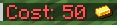</p>

### `<head>`

- **Description**: Adds a head which can be referenced by player name, player UUID or texture path.


- **Subelement**:
  - **Choice of**:
    - `<uuid>` ([_f_](#class-labels), [_uuid_](#type-labels)): the player UUID
    - `<texture>` ([_m_](#class-labels), [_str_](#type-labels)): the texture to the skin
    - `<name>` ([_m_](#class-labels), [_str_](#type-labels)): the player name


- **Attributes**:
  - `outer_layer` ([_l_](#class-labels), [_bool_](#type-labels), [_opt_](#quantity-labels)): whether to include the outer (hat) layer of the skin; default is `false`


- **Example**:
```xml
<head><name>Array64</name></head> <green>Array64 is my IGN!</green>
```

- **Result**: <p></p>

### `<click>`

- **Description**: Applies a click effect to the content within.


- **Subelements (in order)**:
  - `<content>`: the content within
  - **Choice of**:
    - `<run_command>` ([_m_](#class-labels), [_uuid_](#type-labels)): a command to run
    - `<suggest_command>` ([_m_](#class-labels), [_str_](#type-labels)): a command to suggest
    - `<open_url>` ([_m_](#class-labels), [_str_](#type-labels)): a URL to open
    - `<open_file>` ([_m_](#class-labels), [_str_](#type-labels)): a file to open
    - `<change_page>` ([_f_](#class-labels), [_pint_](#type-labels)): a page to flip to (if being displayed in a book)
    - `<copy_to_clipboard>` ([_m_](#class-labels), [_str_](#type-labels)): a string to copy
    <br><br>
    - `<custom>`: sends a custom event to the server
      - **Subelements (in order)**:
        - `<id>` ([_m_](#class-labels), [_str_](#type-labels)): the ID of the event
        - **Choice of**:
          - `<spayload>` ([_m_](#class-labels), [_str_](#type-labels)): string payload (SNBT)
          - `<vpayload>`: variable payload
            - **Attributes**:
              - `src` ([_v_](#class-labels), [_nbt_](#type-labels)): the variable reference to the NBT
    <br><br>
    - `<show_dialog>`: shows a dialog
      - **Attributes**:
        - `src` ([_v_](#class-labels), [_dialog_](#type-labels)): the variable reference to the dialog
    <br><br>
    - `<callback>`: trigger a click callback
      - **Attributes**:
        - `src` ([_v_](#class-labels), [_click_](#type-labels)): the variable reference to the click callback
        - `uses` ([_f_](#class-labels), [_int_](#type-labels), [_opt_](#quantity-labels)): the number of times
the callback can be used for this click event (`-1` for unlimited); default is `1`
        - `duration` ([_f_](#class-labels), [_dur_](#type-labels), [_opt_](#quantity-labels)): the duration that
the callback can be used for this click event (e.g. a duration of `2s` means a click callback will expire 2 seconds after the
text is sent); default is `12h`


- **Example**:
```xml
<click>
  <content>Take some wood!</content>
  <run_command>/give @s minecraft:oak_planks 64</run_command>
</click>
```

- **Result**: <p>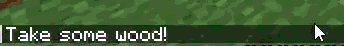</p>

### `<hover>`

- **Description**: Applies a hover effect to the content within.


- **Subelements (in order)**:
  - `<content>`: the content within
  - **Choice of**:
    - `<show_text>`: shows a rich text component on hover
      <br><br>
    - `<show_entity>`: shows an entity on hover
      - **Subelements (in order)**:
        - `<type>` ([_m_](#class-labels), [_str_](#type-labels)): the type of entity (e.g. `minecraft:pig`, `minecraft:boat`)
        - `<uuid>` ([_f_](#class-labels), [_uuid_](#type-labels)): the entity UUID
        - `<name>` ([_opt_](#quantity-labels)): a rich text component name for the entity
    <br><br>
    - `<show_item>`: shows an item on hover
      - **Subelements (in order)**:
        - `<id>` ([_m_](#class-labels), [_str_](#type-labels)): the type of entity (e.g. `minecraft:pig`, `minecraft:boat`)
        - `<count>` ([_f_](#class-labels), [_nnint_](#type-labels), [_opt_](#quantity-labels)): the count of the item; default is `1`
        <br><br>
        - `<sdata>` ([_unlim_](#quantity-labels)): a data component with a value specified through SNBT
          - **Attributes**:
            - `key` ([_m_](#class-labels), [_str_](#type-labels)): the key
          - **Content** ([_m_](#class-labels), [_str_](#type-labels)): the SNBT value
        <br><br>
        - `<vdata>` ([_unlim_](#quantity-labels)): a data component with a value specified through a variable reference
          - **Attributes**:
            - `key` ([_m_](#class-labels), [_str_](#type-labels)): the key
            - `src` ([_v_](#class-labels), [_data_](#type-labels)): the variable reference to the value


- **Example**:
```xml
<b><hover>
  <content><aqua>Array64</aqua></content>
  <show_text>
    Kills: <green>1</green><ln/>
    Assists: <green>2</green>
  </show_text>
</hover> has died!</b>
```

- **Result**: <p>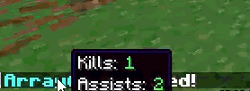</p>

### `<gradient>`

- **Description**: Register a gradient into grassmessage, usable by [&lt;gradref&gt;](#gradref).


- **Subelements (in order)**:
  - `<start>` ([_f_](#class-labels), [_col_](#type-labels)): the start stop color
  - `<middle>` ([_unlim_](#quantity-labels)): a stop between the middle and end
    - **Attributes**:
      - `position` ([_l_](#class-labels), [_frac_](#type-labels)): the position of the stop as a fraction (e.g. `0.5`)
    - **Content** ([_f_](#class-labels), [_col_](#type-labels)): the stop color
  - `<end>` ([_f_](#class-labels), [_col_](#type-labels)): the end stop color


- **Attributes**:
  - `name` ([_l_](#class-labels), [_str_](#type-labels)): the name of the gradient


- **Example**:
```xml
<gradient name="underwater">
  <start>#40E0C0</start>
  <middle position="0.7">#40C0E0</middle>
  <end>#4040E0</end>
</gradient>
```

- **Result**: <p>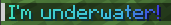</p>

### `<style/>`

- **Description**: Register a style into grassmessage, usable by [&lt;styleref&gt;](#styleref).


- **Attributes**:
  - `name` ([_l_](#class-labels), [_str_](#type-labels)): the name of the style
  - `font` ([_l_](#class-labels), [_str_](#type-labels), [_opt_](#quantity-labels)): the font
  - `color` ([_l_](#class-labels), [_col_](#type-labels), [_opt_](#quantity-labels)): the text color
  - `shadow_color` ([_l_](#class-labels), [_shadcol_](#type-labels), [_opt_](#quantity-labels)): the shadow color
  - `bold` ([_l_](#class-labels), [_bool_](#type-labels), [_opt_](#quantity-labels)): bold?
  - `italic` ([_l_](#class-labels), [_bool_](#type-labels), [_opt_](#quantity-labels)): italic?
  - `underlined` ([_l_](#class-labels), [_bool_](#type-labels), [_opt_](#quantity-labels)): underlined?
  - `strikethrough` ([_l_](#class-labels), [_bool_](#type-labels), [_opt_](#quantity-labels)): strikethrough?
  - `obfuscated` ([_l_](#class-labels), [_bool_](#type-labels), [_opt_](#quantity-labels)): obfuscated?


- **Example**:
```xml
<style name="horror" color="#808080" shadow_color="#FF0000FF" bold="true" obfuscated="true" font="minecraft:uniform"/>
```

- **Result**: <p>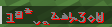</p>

## Unresolved components

Some components need extra information to properly render,
such as scores and players. Without that information, these components fail to display properly.
For example, on Paper, doing
```java
sender.sendMessage(grass.instance("all_players").build());
```
with
```xml
<message name="all_players">
  <selector>
    <pattern>@a</pattern>
  </selector>
</message>
```
will just display `@a`. To solve this, you will need to **resolve** your component. You will need to consult
your platform's documentation to learn how to do this. For example, on Paper, you would do
```java
Component message = grass.instance("all_players").build();
sender.sendMessage(PaperComponents.resolveWithContext(message, sender, null));
```
