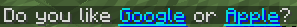
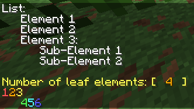
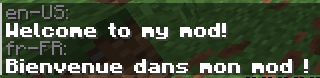

# Tutorial

If you haven't already, follow [GettingStarted.md](GettingStarted.md) to write your first message.

## Elements

grassmessage's XML syntax is designed to be similar to Adventure's MiniMessage.
For example, if you want a bold, light green component that says `Hello, there! You should` next to an aqua, underlined link to `https://google.com` that says `click me!`, your `<message>` element would look like:

```xml
<message name="clickme">
    <b><green>Hello, there! You should</green></b>
    <click>
        <content><aqua><u>click me!</u></aqua></content>
        <open_url>https://google.com</open_url>
    </click>
</message>
```

And the result would be:


Awesome! You can refer to [Elements.md](Elements.md) for a complete breakdown of all available elements.

## Variables

Variables are an important feature in grassmessage. They allow you to turn a static message into a dynamic one.
Variables are referenced in message files as `$(<variable name>)`.

Try replacing `Hello, World!` in your `messages.xml` with `Hello, $(name)!`, then modify your Java code:

```java
Component hello = grass.instance("hello")
    .addString("name", "Mark")
    .build();
```

You should now see:


You can add as many variables as you need for your messages by chaining methods like this:

```java
Component msg = grass.instance("msg")
    .addString("name", "Mark")
    .addInt("page_no", 4)
    .addUUID("player_uuid", UUID.randomUUID())
    .addTextColor("quest_color", TextColor.color(0x50, 0x80, 0xB0))
    .build();
```

## Gradients and Styles

You may have noticed through autocomplete that the root element (`<grass>`) also allows the `<gradients>` and `<styles>` tags directly inside of it.

### Gradients

`<gradients>`, unsurprisingly, helps you declare gradients. For example:

```xml
<gradients>
    <gradient name="peachy">
        <start>#FF7F7F</start>
        <end>#FFCF7F</end>
    </gradient>
</gradients>
```

You can apply this gradient to text using the `<gradref>` element, like this:

```xml
<message name="peachy_greeting">
    <gradref ref="peachy">Hello, World!</gradref>
</message>
```

This is the result:


### Styles

The `<styles>` component helps you style multiple text components the same way without repeating the style.
A style declaration looks like this:

```xml
<styles>
    <style name="link" color="#00FFFF" shadowColor="#0000FFFF" underlined="true"/>
</styles>
```

You can apply this style to text using the `<styleref>` element, like this:

```xml
<message name="companies">
    Do you like
    <styleref ref="link">
        <click>
            <content>Google</content>
            <open_url>https://google.com</open_url>
        </click>
    </styleref>
    or
    <styleref ref="link">
        <click>
            <content>Apple</content>
            <open_url>https://apple.com</open_url>
        </click>
    </styleref>?
</message>
```

This is the result:



## Whitespace

grassmessage collapses and trims whitespace by default.

This enables you to space your XML how *you* prefer, without it having a bearing on the final result.

For example, if you want to create a rainbow out of the text `Red, Orange, Yellow, Green, Blue, Indigo, Violet`,
and you prefer every component on a separate line, you could do it like this:

```xml
<message name="rainbow">
    <red>Red</red>,
    <gold>Orange</gold>,
    <yellow>Yellow</yellow>,
    <green>Green</green>,
    <blue>Blue</blue>,
    <dark_purple>Indigo</dark_purple>,
    <light_purple>Violet</light_purple>
</message>
```

grassmessage will *not* render this message as seven separate lines.


However, if you don't want this behavior, you have quite a few options:

- [Glue](Elements.md#glue): Insert `<glue/>` between two elements/text to ignore the whitespace between them ("glue" them together).
- [Newline](Elements.md#ln): Append `<ln/>` to add a new line. Also ignores neighboring whitespace.
- [Non-Breaking Spaces](Elements.md#nbsp): Insert `<nbsp spaces="X"/>` between two elements/text to add exactly *X* spaces between them. Also ignores neighboring whitespace.
- [Preformatting](Elements.md#pre): Wrap your content in `<pre>` to enable preformatting.

This is what these elements can do together:

```xml
<message name="space_control">
    <pre>
        List:
          Element 1
          Element 2
          Element 3:
            Sub-Element 1
            Sub-Element 2
        
        <yellow>Number of leaf elements: [  <gold>4</gold>  ]</yellow>
    </pre>
    <red>1</red> <glue/>
    <gold>2</gold> <glue/>
    <yellow>3</yellow> <ln/>
    <nbsp spaces="4"/>
    <green>4</green> <glue/>
    <aqua>5</aqua> <glue/>
    <blue>6</blue>
</message>
```

This is the result:



## XInclude

You can also put your messages in multiple files by leveraging XInclude.
This is done by adding the `xmlns:xi="http://www.w3.org/2001/XInclude"` attribute to the `<grass>` element.

For example, you can have an `english_messages.xml` and `french_mesages.xml` file included in the main `messages.yml` file, like so:

`english_messages.xml`:
```xml
<?xml version="1.0" encoding="UTF-8"?>
<messages xmlns="urn:grassmessage" xmlns:xsi="http://www.w3.org/2001/XMLSchema-instance" xsi:schemaLocation="urn:grassmessage urn:grassmessage:schema:v1">
    <message name="en_welcome">
        <b>Welcome to my mod!</b>
    </message>
</messages>
```

`french_messages.xml`:
```xml
<?xml version="1.0" encoding="UTF-8"?>
<messages xmlns="urn:grassmessage" xmlns:xsi="http://www.w3.org/2001/XMLSchema-instance" xsi:schemaLocation="urn:grassmessage urn:grassmessage:schema:v1">
    <message name="fr_welcome">
        <b>Bienvenue dans mon mod !</b>
    </message>
</messages>
```

`messages.xml`:
```xml
<?xml version="1.0" encoding="UTF-8"?>
<grass xmlns:xi="http://www.w3.org/2001/XInclude" xmlns="urn:grassmessage" xmlns:xsi="http://www.w3.org/2001/XMLSchema-instance" xsi:schemaLocation="urn:grassmessage urn:grassmessage:schema:v1">
    <xi:include href="english_messages.xml"/>
    <xi:include href="french_messages.xml"/>
</grass>
```

This is the result:


